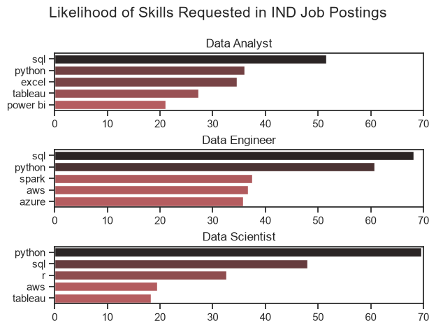
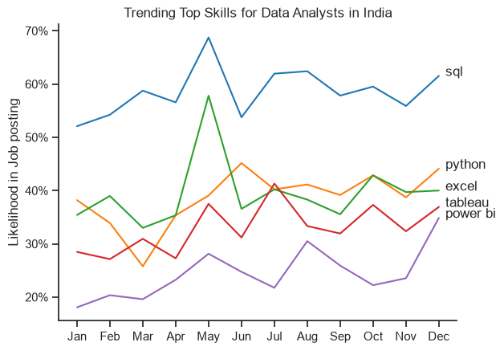
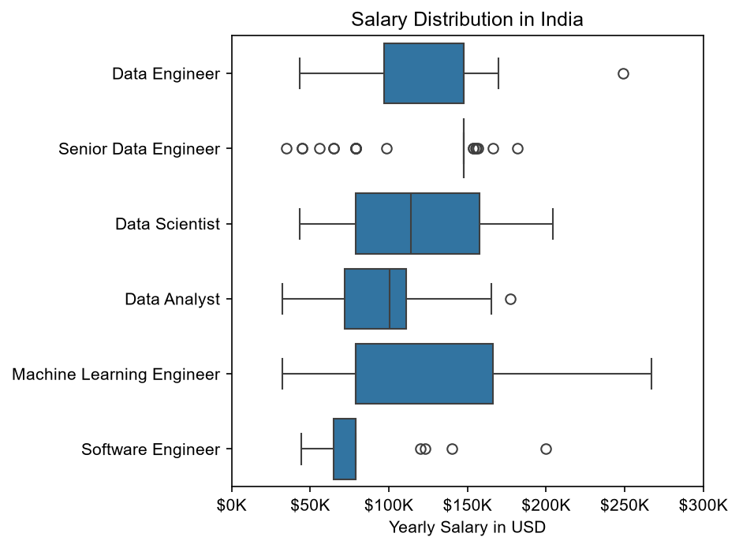
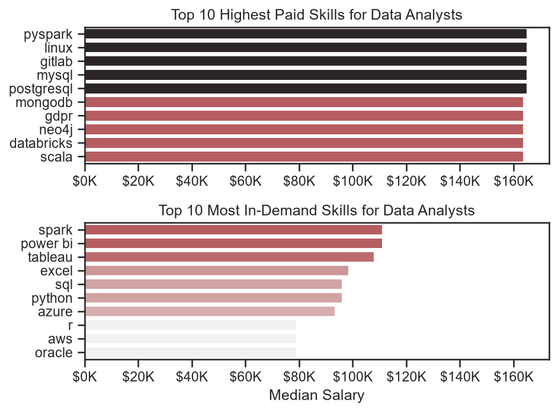
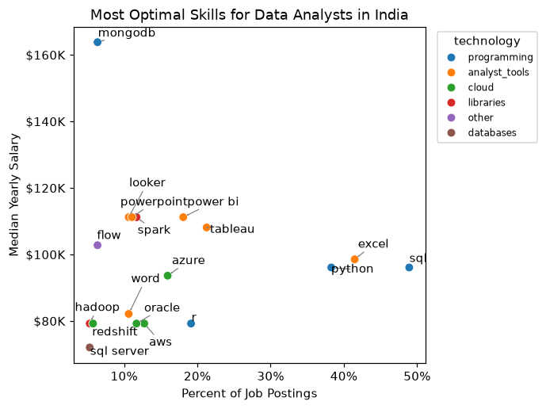

# The Analysis

> **Dataset:** [lukebarousse/data_jobs](https://huggingface.co/datasets/lukebarousse/data_jobs) - 785,741 real-world data job postings from **2023** (Jan 1 - Dec 31). Salaries are stored in **USD** (`salary_year_avg`, `salary_rate=year`) - same scale as US postings, not INR. Trends and medians below reflect the 2023 market.

## 1. What are the most demanded skills for the top 3 most popular data roles?

To find the most demanded skills for the top 3 most popular data roles. I filtered out those positions by which ones were the most popular, and got the top 5 skills for these top 3 roles. This query highlights the most popular job titles and their top skills, showing which skills I should pay attention to depending on the role I'm targeting.

View my notebook with detailed steps here:

[2_Skill_Demand.ipynb](2_Skill_Demand.ipynb)

### Visualize Data

```python

fig, ax = plt.subplots(len(job_titles), 1)
sns.set_theme(style='ticks')
for i, job_title in enumerate(job_titles):

    df_plot = df_skills_perc[df_skills_perc['job_title_short'] == job_title].head(5)

    sns.barplot(data=df_plot, x='skill_percent', y='job_skills', ax=ax[i], hue='skill_count', palette='dark:r_r')

plt.tight_layout()
plt.show()

```

### Results



## Insights: Skill Demand in India Job Postings

- SQL + Python are required for all three roles
- Analysts: SQL, Excel, then a viz tool
- Engineers: SQL, Python, Spark, and cloud
- Scientists: Python first, then SQL and stats

## 2. How are in-demand skills trending for Data Analysts?

### Visualize Data

```python

df_plot = df_DA_IND_percent.iloc[:, :5]

sns.lineplot(data=df_plot, dashes=False, palette='tab10')
sns.set_theme(style='ticks')
sns.despine()

plt.title('Trending Top Skills for Data Analysts in India')
plt.ylabel('Likelihood in Job posting')
plt.xlabel('')
plt.legend().remove()
for i in range(5):
    plt.text(11.2, df_plot.iloc[-1,i], df_plot.columns[i])

from matplotlib.ticker import PercentFormatter

ax = plt.gca()

ax.yaxis.set_major_formatter(PercentFormatter(decimals=0))

plt.show()

```

### Results

*Line chart of the top 5 skills for Data Analysts in India across 2023.*

## Insights: Trending Top Skills for Data Analysts in India

- SQL stays #1 all year (never below ~52%)
- May is the peak month for almost every skill
- Power BI rises all year; Tableau stays flat
- Jun-Sep cools off; Q4 picks back up

## 3. How well do jobs and skills pay for Data Analysts?

### Salary Analysis for Data Nerds
#### Visualize Data

```python
sns.boxplot(data=df_IND_top6, x='salary_year_avg', y='job_title_short', order=job_order)
sns.set_theme(style='ticks')

plt.title('Salary Distribution in India')
plt.xlabel('Yearly Salary in USD')
plt.ylabel('')
plt.xlim(0,300000)

ticks_x = plt.FuncFormatter(lambda y, pos:f'${int(y/1000)}K')
plt.gca().xaxis.set_major_formatter(ticks_x)
plt.show()

```

#### Results



*Box plot visualizing the salary distributions for the top 6 data job titles.*

## Insights: Salary Distribution for Data Jobs in India

- Data Engineer pays best; Software Engineer pays worst
- ML Engineer has the widest pay range
- Senior DE box is a data artifact (same salary repeated)
- Move from DA to DE or DS for a clear pay jump

## Highest Paid and Most In-Demand Skills

### Visualize Data

```python

fig, ax = plt.subplots(2, 1)
sns.set_theme(style='ticks')

#Highest Paid Skills for Data Analysts
sns.barplot(data=df_DA_top_pay, x='median', y=df_DA_top_pay.index, ax=ax[0], hue='median', palette='dark:r_r')
ax[0].legend().remove()
ax[0].set_title('Top 10 Highest Paid Skills for Data Analysts')
ax[0].set_ylabel('')
ax[0].set_xlabel('')
ax[0].xaxis.set_major_formatter(plt.FuncFormatter(lambda x, _: f'${int(x / 1000)}K'))

#Most In-Demand Skills for Data Analysts
sns.barplot(data=df_DA_skills, x='median', y=df_DA_skills.index, ax=ax[1], hue='median', palette='light:r')
ax[1].legend().remove()
ax[1].set_title('Top 10 Most In-Demand Skills for Data Analysts')
ax[1].set_ylabel('')
ax[1].set_xlabel('Median Salary')
ax[1].xaxis.set_major_formatter(plt.FuncFormatter(lambda x, _: f'${int(x / 1000)}K'))
ax[1].set_xlim(ax[0].get_xlim())
 
plt.tight_layout()
plt.show()

```

### Results


*Two separate bar graphs visualizing the highest paid skills and most in-demand skills for data analysts in India.*

## Insights: Highest Paid vs Most In-Demand Skills for Data Analysts in India

- What pays best is not what is asked for most
- Top panel is noise (n=1-6 per skill; DE-style roles)
- Best mix: spark and power bi near $111K
- Learn sql and python first, then power bi or spark

## 4. What is the most optimal skill to learn for Data Analysts?

### Visualize Data

```python
from adjustText import adjust_text
from matplotlib.ticker import PercentFormatter

plt.scatter(plot_df['skill_percent'], plot_df['median_salary'])
texts = []
for i, txt in enumerate(plot_df.index):
    texts.append(plt.text(plot_df['skill_percent'].iloc[i], plot_df['median_salary'].iloc[i], txt))

adjust_text(
    texts,
    x=plot_df['skill_percent'].values,
    y=plot_df['median_salary'].values,
    arrowprops=dict(arrowstyle='->', color='gray', lw=0.8, shrinkA=2, shrinkB=3),
    iter_lim=2000,
    force_text=(0.25, 0.5),
    force_static=(0.2, 0.4),
    force_explode=(0.15, 0.35),
    expand=(1.2, 1.4),
)

plt.xlabel('Percent of Job Postings')
plt.ylabel('Median Yearly Salary')
plt.title('Most Optimal Skills for Data Analysts in India')
ax = plt.gca()
ax.yaxis.set_major_formatter(plt.FuncFormatter(lambda y, pos: f'${int(y / 1000)}K'))
ax.xaxis.set_major_formatter(PercentFormatter(decimals=0))
plt.tight_layout()
plt.show()
```

### Results



## Insights: Most Optimal Skills for Data Analysts in India

- Sweet spot: power bi, tableau, and spark
- mongodb pays most but is rare; sql and excel are common
- No skill wins on both pay and demand
- Core skills first, then one money skill
